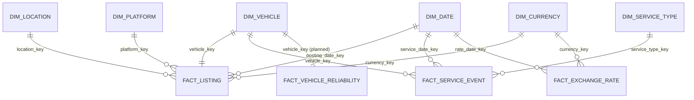

# Gold data model – star schema

The Gold layer turns the cleaned Silver tables into a **dimensional model** for Business and Data Analysts:
a star schema with four fact tables that share the same dimensions (a *fact constellation*), business-ready values
and analyst-friendly names in Unity Catalog.

- Diagram source: [`gold_star_schema.dbml`](gold_star_schema.dbml) – paste it into https://dbdiagram.io to draw the
  diagram (dimensions blue, facts orange). It must list the same columns as `GOLD_COLUMNS` in
  `notebooks/utils/gold_helpers.py` (checked by `tests/test_gold.py`).
- Notebooks: `07_gold_dim_*` (dimensions), `08_gold_fact_*` (facts), `08_gold_views` (views), shared code in
  `notebooks/utils/gold_helpers.py`. Job: `orchestration/databricks_job_gold.yml`.
- The Reliability Score (`fact_vehicle_reliability`) is part of the model but designed in its own step after
  profiling the service book; the table is shown in the diagram as planned.

## Design decisions

| Decision | Why |
|---|---|
| **Star schema, not snowflake** | The dimensions are small or always filtered together (model + manufacturer). A star needs one join per dimension, and BI tools (Power BI) work best with it. A snowflake (`dim_model → dim_manufacturer`) would save almost no space and add joins. |
| **Several fact tables** | Listings, service events and exchange rates are different business events with different grains. One fact table per grain keeps sums correct (service events in the listing table would repeat prices). |
| **`dim_vehicle` is a conformed dimension** | One listing is one vehicle, but the vehicle is also what service events and the reliability score describe. All three facts reference `dim_vehicle`, so "average service cost per manufacturer" is `fact_service_event → dim_vehicle`, without joining two facts. |
| **Model and manufacturer in `dim_vehicle`** | Denormalized (star): every fact reaches the brand through the same key. |
| **Surrogate keys = `xxhash64(natural key)`**, `date_key = yyyyMMdd` | Deterministic: every daily full rebuild gives the same keys without a key mapping table, and dimensions and facts can be built in parallel because both compute the key from the same Silver columns. The natural key stays as a column (`vehicle_id`). Uniqueness is checked on every run (a hash collision would stop it). |
| **Unknown member `-1` in every dimension** | A fact row with a missing natural key (unknown manufacturer, unparsed date, invalid currency) points to `-1` instead of holding null: inner joins never lose rows and reports show "Unknown". |
| **Prices at the posting date stored, current prices as a view** | The price converted at the rate of the posting date never changes, so it is a column of `fact_listing`. Prices at today's rates change daily, so they are the view `vw_listing_current_price`. This is why Silver keeps the full exchange rate history. |
| **SCD Type 1** | The sources are full snapshots without a history of attribute changes, so Type 2 would track changes that do not exist in the data. It can be added when the sources deliver changes over time. |
| **Full overwrite every day** | Same pattern as Silver; the data is small (Gold is rebuilt in a few minutes). |
| **`dim_date` 1950-01-01 → 2030-12-31** | Service dates go back to 1950 (the lower bound Silver accepts); the fixed end leaves room for planning and BI filters and keeps the table stable. ~29,600 rows. A fact date outside the range fails the foreign-key check. |
| **Rows with DQ issues stay** | Invalid values are already null in Silver; `is_valid` / `dq_issues` let analysts filter. |
| **Analyst names = Unity Catalog views** | The containers have no External Location, so tables cannot be registered by name; `08_gold_views` creates `dbw_used_cars_strahinja.gold.<table>` views over the Delta paths (same pattern as the Silver view). |

## Diagram



The full diagram with all columns is in `gold_star_schema.dbml`.

## Dimensions

### `gold.dim_date`
**Grain:** one calendar day, 1950-01-01 → 2030-12-31, plus Unknown (`-1`). Generated, not read from Silver.
**Role-playing:** posting date (`fact_listing`), service date (`fact_service_event`), rate date (`fact_exchange_rate`).

| Column | Type | Rule |
|---|---|---|
| `date_key` | int | `yyyyMMdd`; `-1` = Unknown |
| `date` | date | |
| `year`, `quarter`, `month` | int | |
| `month_name` | string | `November` |
| `week_of_year` | int | ISO week |
| `day_of_week` | int | ISO: Monday = 1 … Sunday = 7 |
| `day_name` | string | `Saturday` |
| `is_weekend` | boolean | Saturday or Sunday |

### `gold.dim_vehicle`
**Grain:** one vehicle (`vehicle_id` of `silver.vehicle_listings`), plus Unknown. **Key:** `vehicle_key = xxhash64(vehicle_id)`.

| Column | Silver source | Rule |
|---|---|---|
| `vehicle_key` | `vehicle_id` | surrogate key |
| `vehicle_id`, `vin`, `manufacture_year`, `cylinders`, `listing_url` | same name | as in Silver |
| `manufacturer` | `manufacturer` | display name: Title Case with exceptions (`BMW`, `GMC`, `Mercedes-Benz`, `Alfa Romeo`, …); `Unknown` when not mapped |
| `model` | `model` | `Unknown` when missing |
| `manufacturer_source` | `manufacturer_source` | `lookup` / `listing_url` / `unknown` |
| `condition`, `fuel`, `transmission`, `drive`, `size`, `body_type`, `paint_color`, `title_status` | same name | Title Case (`Like New`), `Unknown` when missing |
| `has_service_history` | `silver.service_events` | true when the vehicle has at least one service event |

Not carried into Gold: `description`, `image_url`, `region_url`, `posting_date_raw`, `source_system_uuid`,
`model_normalized` and the lineage columns (technical or heavy; `description` is most of the Silver table's size).

### `gold.dim_location`
**Grain:** distinct `state` + `region` of the listings, plus Unknown. **Key:** `xxhash64(state, region)`; a listing
without both values points to `-1`. Missing parts are shown as `Unknown`.

### `gold.dim_platform`
**Grain:** listing platform (`platform_id`: 1 Craigslist, 2 CarGurus, 3 AutoScout24, 4 CarsGuide), plus Unknown.
**Key:** `xxhash64(platform_id)`.

### `gold.dim_currency`
**Grain:** currency (EUR, USD, GBP, AUD – the currencies Silver accepts) with its name, plus Unknown.
**Key:** `xxhash64(currency_code)`.

### `gold.dim_service_type`
**Grain:** each distinct combination of the service classification columns of `silver.service_events`
(`service_type`, `event_type`, `maintenance_kind`, `severity`, `is_maintenance`, `is_repair`, `is_inspection`,
`is_oil_change`) – a *junk dimension* of a few dozen rows that keeps eight low-cardinality columns out of the
8.3M-row fact. **Key:** `xxhash64` of all eight columns. Text values missing in Silver are shown as `Unknown`.

## Facts

### `gold.fact_listing`
**Grain:** one vehicle listing. **Key:** `vehicle_key` (one listing = one vehicle).

| Column | Rule |
|---|---|
| `vehicle_key`, `posting_date_key`, `location_key`, `platform_key`, `currency_key` | foreign keys; `-1` when the natural key is missing |
| `price` | original currency (Silver) |
| `price_eur_at_posting`, `price_gbp_at_posting`, `price_usd_at_posting`, `price_aud_at_posting` | `round(price / rate(currency) * rate(target), 2)` at the rates of `fx_rate_date`; null without price, currency, posting date, or before the first rate |
| `fx_rate_date` | last ECB working day **on or before** the posting date (a Saturday listing uses Friday's rates) |
| `odometer`, `latitude`, `longitude` | as in Silver (odometer unit not confirmed) |
| `source_system` | degenerate dimension: source file (First … Fourth) |
| `is_valid`, `dq_issues` | Silver data quality |

Checks: same row count as `silver.vehicle_listings`, unique key, every foreign key exists in its dimension, every
price with a currency and a posting date after the first rate is converted.

### `gold.fact_service_event`
**Grain:** one service event. **Key:** `service_event_id` (degenerate, from Silver).

| Column | Rule |
|---|---|
| `vehicle_key`, `service_date_key`, `service_type_key` | foreign keys; a vehicle without a listing → `-1` (0 on the full data, logged as a warning) |
| `cost_eur`, `downtime_days`, `odometer_km`, `km_since_prev`, `oil_gap_km`, `oil_gap_penalty` | measures, as in Silver |
| `is_skipped_service`, `is_valid` | flags |

Checks: same row count and the same `cost_eur` total as Silver, unique key, foreign keys.

### `gold.fact_exchange_rate`
**Grain:** one ECB working day and currency. `rate_per_eur` (1 EUR = rate × currency); EUR is added with 1 for every
day, so any price converts with one join: `price / rate(listing currency) * rate(target)`.
Checks: Silver rows + one EUR row per day, unique (`rate_date_key`, `currency_key`), foreign keys.

### `gold.fact_vehicle_reliability` (planned)
**Grain:** one vehicle. The score (0–100) and its components are defined in the Reliability Score step.
Vehicles without service history get no score (null = unknown), not 100.

## Views

| View | Content |
|---|---|
| `gold.<table>` (one per table) | `SELECT *` from the Delta table, for querying by name |
| `gold.vw_listing_current_price` | every listing's price at the **latest** rates: `price_eur_current`, `price_gbp_current`, `price_usd_current`, `price_aud_current`, `fx_rate_date_key` |

`dev_mode=true` writes `*_dev` tables and registers `*_dev` views.

## Example queries

```sql
-- Average listing price per manufacturer in GBP at the posting date
SELECT v.manufacturer, count(*) AS listings, round(avg(f.price_gbp_at_posting), 2) AS avg_price_gbp
FROM dbw_used_cars_strahinja.gold.fact_listing f
JOIN dbw_used_cars_strahinja.gold.dim_vehicle v USING (vehicle_key)
GROUP BY v.manufacturer ORDER BY listings DESC;

-- Repairs per year of service
SELECT d.year, count(*) AS repairs
FROM dbw_used_cars_strahinja.gold.fact_service_event e
JOIN dbw_used_cars_strahinja.gold.dim_service_type t USING (service_type_key)
JOIN dbw_used_cars_strahinja.gold.dim_date d ON d.date_key = e.service_date_key
WHERE t.is_repair
GROUP BY d.year ORDER BY d.year;
```

## Load flow

```
silver.vehicle_listings ─┬─► 07_gold_dim_vehicle ─┐
silver.service_events ───┼─► 07_gold_dim_small ───┤
(generated) ─────────────┴─► 07_gold_dim_date ────┼─► 08_gold_fact_listing ───────┐
silver.exchange_rates ────────────────────────────┼─► 08_gold_fact_service_event ─┼─► 08_gold_views
                                                  └─► 08_gold_fact_exchange_rate ─┘
```

Databricks Job `gold` (parameters `dev_mode`, `ingestion_date`), started by `pl_daily_master` after the Silver Jobs.
