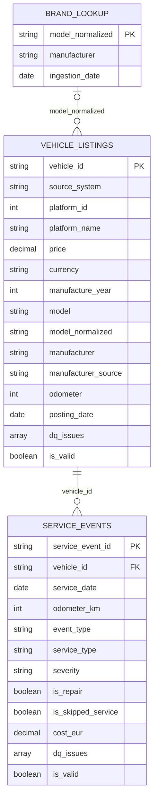

# Silver Layer – Data Model

This document describes the Silver layer tables built from the Bronze layer: their purpose, grain,
keys, columns, cleaning rules and the assumptions they rely on.

Notebooks:
- `notebooks/02_silver_stage_first_source.py`, `..._second_source.py`, `..._third_source.py`,
  `..._fourth_source.py` → one stage table per vehicle source (`vehicle_listings_stage/<source>`)
- `notebooks/02_silver_brand_lookup.py` → `silver.brand_lookup` (cleaned `model_to_brand_lookup.csv`)
- `notebooks/03_silver_vehicle_listings.py` → `silver.vehicle_listings` (union of the stage tables + brand mapping)
- `notebooks/04_silver_service_events.py` → `silver.service_events`

Shared code: `notebooks/00_config.py` (storage access, paths, sources),
`notebooks/utils/silver_transformations.py` (reusable cleaning functions) and
`notebooks/utils/vehicle_listings_cleaning.py` (cleaning rules and checks shared by the four vehicle sources).

## Design principles

- **One Silver table per business entity.** The four vehicle source systems describe the same entity
  (a vehicle listing) with an identical 28-column schema, so they are combined into one table.
  The service book is a different entity (service events) and gets its own table.
  Gold builds `dim_*` / `fact_*` tables (with SCD Type 2 where relevant) on top of these tables.
- **Silver keeps the truth.** An impossible value (for example a price of 3.7 billion) is set to `null`
  and recorded in `dq_issues`, but **the row is never deleted**. Filtering invalid rows and replacing
  `null` with defaults such as `"Unknown"` / `-1` happens in Gold.
- **Explicit typing.** Bronze data is read without schema inference. Every column is cast explicitly
  with `try_cast`, so a bad value becomes `null` instead of failing the job.
- **Lineage on every row.** `source_system`, `source_file_path`, `ingestion_date` and `silver_processed_at`
  show where each row came from and when it was processed.
- **No partitioning.** Both tables are far below the size where partitioning helps (Databricks guidance:
  tables of ~1 TB or more, with partitions of at least ~1 GB). Partitioning by `year(service_date)`
  would also produce fake partitions from invalid dates (1900, 2101) and a null partition.
- **Controlled file count.** `vehicle_listings` is repartitioned to 4 files (~200 MB each) before writing.
  Without it, the union of four deduplicated sources (~200 shuffle partitions each) was written as ~800 files of ~1 MB
  (the "small files problem", which slows down reads). `service_events` is written as ~14 files of ~54 MB without extra steps.

## Storage and catalog

- Tables are **path-based Delta tables** in the `silver` container:
  `abfss://silver@sausedcarspipelinesv.dfs.core.windows.net/vehicle_listings`, `.../brand_lookup` and
  `.../service_events`
  (`*_dev` suffix when a notebook runs with `dev_mode=true`).
- They are **not registered in the catalog**. The Databricks workspace uses Unity Catalog (catalog
  `dbw_used_cars_strahinja`), and registering a table on an `abfss://` path requires a Unity Catalog
  *External Location* (backed by a *Storage Credential*), which only an admin can create. Without it,
  `CREATE TABLE ... LOCATION` fails with `NO_PARENT_EXTERNAL_LOCATION_FOR_PATH`.
- Managed Unity Catalog tables were rejected because their data would not live in the project's `silver` container.
- How to read the tables:
  - Python: `spark.read.format("delta").load("abfss://silver@sausedcarspipelinesv.dfs.core.windows.net/vehicle_listings")`
  - SQL: ``SELECT * FROM delta.`abfss://silver@sausedcarspipelinesv.dfs.core.windows.net/vehicle_listings` ``
- Once an External Location exists for the `silver` and `gold` containers, the tables can be registered
  (`CREATE TABLE ... LOCATION`) without moving any data.
- The names `silver.vehicle_listings` / `silver.service_events` in this document are logical names.

## Load strategy and assumptions

- **Assumption: every Bronze ingestion is a full snapshot.** The ADF pipeline `pl_ingest_bronze_sources`
  copies the complete source files into a new `ingestion_date=YYYY-MM-DD/` folder on every run.
- Each Silver notebook therefore reads **one** Bronze partition (the latest, or the one passed through
  the `ingestion_date` widget) and **overwrites** the whole Silver table. Re-running a notebook is
  idempotent and produces no duplicates across days.
- Silver always holds the latest state. Earlier states remain in the Bronze partitions and in the
  Delta table history (`VERSION AS OF`). Changes over time are tracked in Gold with SCD Type 2.
- Backfills must be run in chronological order, because the last processed date becomes the Silver state.
- If a source ever becomes incremental, `overwrite` must be replaced by a Delta `MERGE` on the table key.
- **Validation never depends on the run date.** Rules such as "not in the future" compare with the
  `ingestion_date` of the Bronze partition, not with `current_date()`. The same Bronze input therefore gives the
  same Silver output on any day (re-runs and backfills). Only `silver_processed_at` changes between runs.
- *To be confirmed with the mentor.*

## Load flow and pipeline tasks

Every vehicle source is loaded by its **own notebook** (its own pipeline task). In real life sources change
independently (new columns, other formats), so a change in one source must not touch the others. The cleaning
rules that are the same for every source are written once in `utils/vehicle_listings_cleaning.py`; a source
notebook holds only what is specific to its source (reader options via `VEHICLE_SOURCES`, expected currencies,
notes) and its own checks and DQ report.

```
Bronze <Source>/ingestion_date=…  ──►  02_silver_stage_<source>_source  ──►  silver/vehicle_listings_stage/<source> ─┐
                                       (×4, independent, in parallel)                                                 │
Bronze Lookup/ingestion_date=…    ──►  02_silver_brand_lookup           ──►  silver/brand_lookup ──────────────────────┤
                                       (in parallel with the 4 sources)                                               ▼
                                                                       03_silver_vehicle_listings  ──►  silver/vehicle_listings
Bronze ServiceBook/ingestion_date=…  ──►  04_silver_service_events  ──►  silver/service_events
```

- **Stage tables** (`vehicle_listings_stage/first|second|third|fourth`, path-based Delta, one file each) hold one
  cleaned source in the common 36-column shape (no brand columns yet). Pipeline tasks cannot share DataFrames,
  so the result of a source task is stored for the next task. They are internal: analysts use `vehicle_listings`.
- `03_silver_vehicle_listings` reads the four stage tables and the brand lookup and **stops** if one is missing
  or if they come from different ingestion dates (otherwise the table would mix two days). Then it unions the
  sources, maps the brands and checks that `vehicle_id` is unique across all sources.
- The vehicle notebooks run as the Databricks Job `silver_vehicle_listings`
  (`orchestration/databricks_job_silver_vehicle_listings.yml`): `validate_landing_and_bronze` (01,
  `sources=vehicle_listings`) first, then the four `stage_<source>_source` tasks and `brand_lookup` (02) in
  parallel; `vehicle_listings` (03) runs only when all five tasks succeeded. The service book runs as the Job
  `silver_service_events` (01 with `sources=service_book` → 04).
- Both Jobs are started every day by the ADF master pipeline `pl_daily_master`, after the landing → Bronze copy,
  and `silver_service_events` runs after `silver_vehicle_listings`. Details, parameters and authentication:
  `documentation/orchestration.md`.
- Verified on 2026-11-06 as the earlier Job `silver_daily` (full run, Bronze `ingestion_date=2026-11-05`,
  5 min 32 s including cluster start), and again on 2026-11-09 through ADF (`ingestion_date=2026-11-09`) with the
  same numbers:
  - stage tables: 4 × 106,970 rows;
  - `vehicle_listings`: 427,880 rows;
    - valid %: First 94.20, Second 94.29, Third 94.46, Fourth 94.32;
    - brands: lookup 412,552, listing URL 3,181, unknown 12,147;
  - `service_events`: 8,312,490 rows, with 100% of service-book vehicles present in `vehicle_listings`.

  The results equal the runs before the split, so splitting per source and validating against
  `ingestion_date` changed no data.
- Verified again on 2026-11-10 after moving the lookup cleaning into its own task and giving the lookup a Bronze
  date partition (ADF Debug of `pl_daily_master`, `ingestion_date=2026-11-10`, Silver rebuilt from an empty
  `silver` container): `brand_lookup` 23,756 models / 44 manufacturers; `vehicle_listings` and `service_events`
  with exactly the numbers above (brands per source: lookup 96.26 / 96.40 / 96.52 / 96.49 % for
  First / Second / Third / Fourth).
- DQ issues on the full vehicle data (2026-11-09): invalid_manufacture_year 10,739, invalid_latitude 9,987,
  invalid_longitude 9,987, zero_odometer 1,972, invalid_vin 1,602, invalid_odometer 578, invalid_price 50.

## Source profiling summary (ingestion 2026-11-03)

The full, reproducible profiles are Databricks notebooks in `notebooks/profiling/` (read-only, not part of the
daily pipeline): `01_profile_vehicle_sources` (widget `source` = one source or `all`),
`02_profile_service_book` and `03_profile_brand_lookup`. Each ends with a "Findings → decisions" table.

| Source | Format | Rows | Currency | Notes |
|---|---|---|---|---|
| FirstSourceSystem | CSV | 106,970 | GBP / USD / AUD / EUR (by platform) | empty values are `""` |
| SecondSourceSystem | Parquet (Snappy) | 106,970 | EUR | lat/long values outside valid ranges |
| ThirdSourceSystem | Avro | 106,970 | AUD | |
| FourthSource | NDJSON (no extension) | 106,970 | GBP | |
| ServiceBook | CSV | 8,312,490 | EUR (`cost_eur`) | 419,641 distinct cars |

Findings that shaped the model:
- All four vehicle sources share the same 28 columns. `id` is unique within each file and there is no
  overlap between files.
- `id` identifies the **car**. ServiceBook `car_id` matches it for ~98% of the checked listings.
- `SourceSystemId` (UUID) is constant per file and identifies the source system. `source_system_id` /
  `source_system_name` identify the **listing platform** (1 Craigslist, 2 CarGurus, 3 AutoScout24,
  4 CarsGuide), and platforms are mixed inside every file.
- `posting_date` uses one format per platform: Craigslist `MM/dd/yyyy`, CarGurus `yyyy-MM-dd`,
  AutoScout24 `dd.MM.yyyy`, CarsGuide `MMMM d, yyyy` (e.g. `April 12, 2021`).
- Extreme values: price up to 3.7 billion, year up to 2100, odometer up to 10,000,000,
  latitude ±199, longitude ±399.
- ServiceBook: `root_cause`, `warranty_flag` and `is_tyre` have a single value in all rows.
  `service_date` ranges from 1900 to 2101. 117 pairs of REPAIR events share car, date, odometer and event type,
  but no row is identical in every column: they differ in `cost_eur`, `downtime_days` and the odometer chain,
  so they are two real repairs on the same day and both are kept.
  `km_since_prev` is negative exactly when `odometer_monotonic_flag = 0`.
- Both CSV files use Windows line endings (`\r\n`). `FirstSourceSystem.csv` also has 5,277 bare carriage
  returns (`\r`) inside quoted `description` values (2,558 rows). Spark treats a bare `\r` as a line end, so
  without `multiLine` those rows are split into broken rows (a raw read gives 111,332 rows with 4,362 malformed ids; the Silver table showed 108,156 after deduplication, instead of
  106,970 rows). First is therefore read with `multiLine=true`. `ServiceBook.csv` has `\r` only in its
  line endings and is read without `multiLine`, which keeps the 1.2 GB read parallel.
- Every listing `id` and ServiceBook `car_id` is exactly 12 lower-case hex characters. The vehicle notebooks use
  this as a **structural check**: a `vehicle_id` with any other shape means a file was parsed wrongly, and
  the run stops before writing.

## Entity-relationship diagram



The relationships are logical only. Service events → listings is measured (coverage %) but not enforced.
Listings → brand lookup is used once, to fill `manufacturer`; listings whose model is not in the lookup get the
brand from the URL or none.

---

## `silver.vehicle_listings`

**Purpose:** one cleaned, standardized dataset of all vehicle listings from the four source systems,
with a single schema and correct data types. It is the input for brand/model mapping, currency
conversion and the Gold vehicle/listing tables.

**Grain:** one row per listing (one car). **Key:** `vehicle_id`.
**Combined sources:** FirstSourceSystem + SecondSourceSystem + ThirdSourceSystem + FourthSource
(each cleaned by its own stage notebook, then `unionByName` over a fixed column list in `03_silver_vehicle_listings`).

| Column | Source column | Type | Transformation / rule | DQ issue |
|---|---|---|---|---|
| `vehicle_id` | `id` | string | trim; deduplicated (latest `posting_date` wins) | — |
| `source_system` | (file) | string | `First` / `Second` / `Third` / `Fourth` | — |
| `source_system_uuid` | `SourceSystemId` | string | trim | — |
| `platform_id` | `source_system_id` | int | cast | — |
| `platform_name` | `source_system_name` | string | trim | — |
| `listing_url` | `url` | string | trim | — |
| `region` | `region` | string | lower, trim | — |
| `region_url` | `region_url` | string | trim | — |
| `state` | `state` | string | upper; must match `^[A-Z]{2}$` | `invalid_state` |
| `latitude` | `lat` | double | must be within [-90, 90] | `invalid_latitude` |
| `longitude` | `long` | double | must be within [-180, 180] | `invalid_longitude` |
| `price` | `price` | decimal(18,2) | must be > 0 and ≤ 1,000,000 | `invalid_price` |
| `currency` | `currency` | string | upper; must be USD, GBP, EUR or AUD | `invalid_currency` |
| `manufacture_year` | `year` | int | must be ≥ 1900 and ≤ posting year + 1 (ingestion year + 1 when `posting_date` is null) | `invalid_manufacture_year` |
| `model` | `model` | string | trim, repeated spaces collapsed | — |
| `model_normalized` | `model` | string | trim, single spaces, lower case; join key for brand mapping | — |
| `manufacturer` | lookup / `url` | string | brand from `model_to_brand_lookup.csv`, else from the listing URL, else null (see Brand mapping) | — |
| `manufacturer_source` | — | string | `lookup`, `listing_url` or null (manufacturer unknown) | — |
| `condition` | `condition` | string | lower, trim | — |
| `cylinders` | `cylinders` | int | `"6 cylinders"` → 6; `"other"` → null | — |
| `fuel` | `fuel` | string | lower, trim | — |
| `odometer` | `odometer` | int | must be ≥ 0 and ≤ 1,000,000; `0` is flagged but kept | `invalid_odometer`, `zero_odometer` |
| `title_status` | `title_status` | string | lower, trim | — |
| `transmission` | `transmission` | string | lower, trim | — |
| `vin` | `VIN` | string | upper; must match `^[A-HJ-NPR-Z0-9]{17}$` | `invalid_vin` |
| `drive` | `drive` | string | lower, trim | — |
| `size` | `size` | string | lower, trim | — |
| `body_type` | `type` | string | lower, trim (renamed: `type` is a reserved word) | — |
| `paint_color` | `paint_color` | string | lower, trim | — |
| `image_url` | `image_url` | string | trim | — |
| `description` | `description` | string | trim | — |
| `posting_date` | `posting_date` | date | parsed with the format matching the value's pattern | `unparsed_posting_date` |
| `posting_date_raw` | `posting_date` | string | original value, kept for audit | — |
| `ingestion_date` | Bronze folder name | date | lineage | — |
| `source_file_path` | `_metadata.file_path` | string | lineage | — |
| `silver_processed_at` | — | timestamp | `current_timestamp()` | — |
| `dq_issues` | — | array<string> | list of issue codes for the row | — |
| `is_valid` | — | boolean | `size(dq_issues) = 0` | — |

**Odometer unit:** the source does not state whether `odometer` is in kilometres or miles
(Craigslist is a US platform), so the column is named `odometer` without a unit suffix.
It will be renamed once the unit is confirmed.

**Not done here:** currency conversion (Silver view, later), default values for `null`,
removal of invalid rows (Gold).

### Brand mapping (model → manufacturer)

Based on `notebooks/profiling/03_profile_brand_lookup.py`. Steps 1–2 are done by `02_silver_brand_lookup`
(`clean_brand_lookup`, stored as [`silver.brand_lookup`](#silverbrand_lookup)); steps 3–5 by
`03_silver_vehicle_listings` (`add_manufacturer`).

1. **Clean the lookup:** model normalized like `model_normalized`, manufacturer lower-cased, duplicates removed.
   This removes the 91 Title Case copies (`Tacoma, Toyota` next to `tacoma, toyota`) → 45 manufacturers.
2. **Conflicts are not guessed:** a model that maps to more than one manufacturer (`astra` → saturn / opel)
   is removed from the lookup. `opel` has no other model, so the cleaned lookup has 23,756 models and
   44 manufacturers (verified on the cluster).
3. **Lookup join** (broadcast, left) on `model_normalized` → `manufacturer_source = 'lookup'`
   (96.26–96.52% of listings per source; 412,552 listings = 96.42% in total).
4. **URL fallback** for the rest: the first known manufacturer that appears as a whole word in the listing URL
   slug (`.../d/new-castle-2018-cadillac-xt5-crossover/...`; spaces in names are `-` in URLs, longer names are
   tried first) → `manufacturer_source = 'listing_url'` (3,181 listings = 0.74%). It also recovers models whose text
   lost its first characters in the source (`lac xt5 crossover`, `des-benz cla`).
5. **Otherwise null** (12,147 listings = 2.84%). Brands missing from the lookup (scion, freightliner, hummer, ...) stay unknown.
   An unknown manufacturer is missing data, not an invalid value, so it is not a DQ issue.

`03` checks that the lookup comes from the same ingestion as the stage tables, that its key is unique and that
the row count is unchanged after the join.

---

## `silver.brand_lookup`

**Purpose:** the cleaned brand reference (`model_to_brand_lookup.csv`): one manufacturer per normalized model.
Used by `03_silver_vehicle_listings` for the brand mapping and later by Gold (`dim_brand_model`).

**Grain:** one row per `model_normalized`. **Key:** `model_normalized` (unique, checked before writing).
**Rows:** 23,756 models, 44 manufacturers (raw file: 23,848 rows; verified on the cluster 2026-11-10: 90 rows
removed as empty or duplicate after normalization, 2 rows of the conflicting `astra`). **Notebook:** `02_silver_brand_lookup`.

| Column | Source | Type | Rule |
|---|---|---|---|
| `model_normalized` | `model` | string | trim, single spaces, lower case (same as in `vehicle_listings`) |
| `manufacturer` | `manufacturer` | string | lower case |
| `ingestion_date` | Bronze partition | date | lineage; must equal the stage tables' date in `03` |
| `source_file_path` | Bronze file | string | lineage |
| `silver_processed_at` | — | timestamp | lineage |

- Rows without a model or manufacturer and duplicate rows after normalization (the 91 Title Case copies) are
  removed; a model with several manufacturers (`astra`) is removed. The DQ report of the notebook shows how many
  rows each step removed and lists the conflicting models.
- The lookup is reference data, not a list of facts, so removed rows are not kept with `dq_issues` (unlike the
  listings): a kept conflicting row would break the unique join key.
- `dev_mode=true` still reads the whole lookup (a sample would leave most listings without a brand) and writes
  `brand_lookup_dev`.
- In Bronze the lookup has a date partition like every source (`Lookup/ingestion_date=YYYY-MM-DD/`, since
  2026-11-10; before that ADF overwrote one file in `Lookup/`). Each day's run therefore uses that day's lookup,
  and a backfill uses the lookup of the backfilled day. Ingestions before 2026-11-10 have no lookup partition,
  so they can no longer be reprocessed.

---

## `silver.service_events`

**Purpose:** a cleaned service history per car, with correct types and no duplicates.
It is the basis for the Reliability Score in Gold.

**Grain:** one row per service event.
**Key:** `service_event_id` = `sha2` over **all** raw source columns (joined with `||`), computed before any
cleaning, so the key stays stable even when a value is later nulled by validation. A shorter key
(car, date, odometer, event type) is not unique: the source has 117 pairs of real repairs on the same day.
Only rows identical in every column are removed as duplicates (none in the 2026-11-03 ingestion).
**Relationship:** `vehicle_id` → `vehicle_listings.vehicle_id` (many-to-one, not enforced).

| Column | Source column | Type | Transformation / rule | DQ issue |
|---|---|---|---|---|
| `service_event_id` | — | string | SHA-256 hash (see above); only fully identical rows are deduplicated | — |
| `vehicle_id` | `car_id` | string | trim; renamed to match `vehicle_listings` | — |
| `service_date` | `service_date` | date | `try_cast` to date; must be ≥ 1950-01-01 and ≤ `ingestion_date` | `unparsed_service_date`, `invalid_service_date` |
| `odometer_km` | `odometer_km` | int | must be ≥ 0 and ≤ 2,000,000 | `invalid_odometer_km` |
| `event_type` | `event_type` | string | upper (MAINTENANCE / INSPECTION / REPAIR / UNKNOWN) | — |
| `service_type` | `service_type_raw` | string | upper snake case (`Oil Change` → `OIL_CHANGE`) | — |
| `maintenance_kind` | `maintenance_kind` | string | upper | — |
| `severity` | `severity` | string | upper (LOW / MEDIUM / HIGH) | — |
| `is_maintenance` | `is_maintenance` | boolean | `1` → true, `0` → false | — |
| `is_repair` | `is_repair` | boolean | `1` → true, `0` → false | — |
| `is_inspection` | `is_inspection` | boolean | `1` → true, `0` → false | — |
| `is_oil_change` | `is_oil_change` | boolean | `1` → true, `0` → false | — |
| `interval_km_target` | `interval_km_target` | int | cast | — |
| `prev_odometer_km` | `prev_odometer_km` | int | cast (kept from source) | — |
| `km_since_prev` | `km_since_prev` | int | cast (kept from source; negative when the odometer went backwards) | — |
| `is_odometer_monotonic` | `odometer_monotonic_flag` | boolean | `1` → true, `0` → false | `non_monotonic_odometer` |
| `oil_gap_km` | `oil_gap_km` | int | cast | — |
| `oil_gap_penalty` | `oil_gap_penalty_piece` | double | cast | — |
| `cost_eur` | `cost_eur` | decimal(10,2) | cast | — |
| `downtime_days` | `downtime_days` | int | cast | — |
| `notes` | `notes_raw` | string | trim | — |
| `is_skipped_service` | `notes_raw` | boolean | `lower(notes) = 'skipped'` | — |
| `ingestion_date` | Bronze folder name | date | lineage | — |
| `source_file_path` | `_metadata.file_path` | string | lineage | — |
| `silver_processed_at` | — | timestamp | `current_timestamp()` | — |
| `dq_issues` | — | array<string> | list of issue codes for the row | — |
| `is_valid` | — | boolean | `size(dq_issues) = 0` | — |

**Dropped source columns:**
- `root_cause`, `warranty_flag`, `is_tyre`: a single value in all 8.3M rows, so they carry no information.
  The notebook re-checks this on every run and prints a warning if they ever start to vary.
- `desc_all`: only `lower(service_type_raw + notes_raw)`, so it can be derived again.

---

## Common cleaning rules

1. **One representation of "missing".** `""`, whitespace-only strings, `"null"`, `"none"`, `"nan"` and
   `"n/a"` (case-insensitive) become `null` in every string column. `NaN` becomes `null` in numeric columns.
2. **Explicit types** with `try_cast`, without schema inference.
3. **snake_case column names**, with the same name for the same concept in every table (`vehicle_id`).
4. **Strings are trimmed.** Descriptive categories are lower case. Codes (`event_type`, `severity`,
   `state`, `currency`) are upper case.
5. **One date type.** The original value is kept when the source used several formats.
   Dates are parsed with `try_to_date` / `try_cast` because Databricks Runtime 18 runs with ANSI mode on,
   where `to_date` fails the whole job on an impossible date such as `02/30/2021`.
   A date that cannot be parsed (unknown format or impossible calendar date) becomes `null` and is flagged
   `unparsed_posting_date` / `unparsed_service_date`. The notebook prints a warning with examples
   and **does not stop**.
6. **Validation:** an impossible value becomes `null` and its issue code is added to `dq_issues`.
   Rows are never deleted.
7. **Deduplication** on the table key.
8. **Lineage columns** on every row.

## Silver view (planned)

Currency conversion will not be stored in `vehicle_listings`. A daily job will load exchange rates
into `silver.exchange_rates`. The view `silver.vw_vehicle_listings_priced` will join each listing's
`price` / `currency` with the latest rates to expose `price_usd`, `price_gbp` and `price_aud`.
Because a view is computed when it is queried, new rates show up in the converted prices without
rewriting the listings table.
