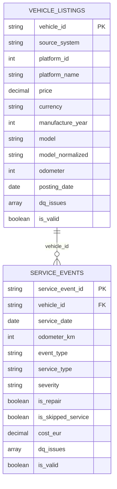

# Silver Layer – Data Model

This document describes the Silver layer tables built from the Bronze layer: their purpose, grain,
keys, columns, cleaning rules and the assumptions they rely on.

Notebooks:
- `notebooks/02_silver_vehicle_listings.py` → `silver.vehicle_listings`
- `notebooks/03_silver_service_events.py` → `silver.service_events`

Shared code: `notebooks/00_config.py` (storage access, paths, sources) and
`notebooks/utils/silver_transformations.py` (reusable cleaning functions).

## Design principles

- **One Silver table per business entity.** The four vehicle source systems describe the same entity
  (a vehicle listing) with an identical 28-column schema, so they are combined into one table.
  The service book is a different entity (service events) and gets its own table.
  Gold builds `dim_*` / `fact_*` tables (with SCD Type 2 where relevant) on top of these tables.
- **Silver keeps the truth.** An impossible value (for example a price of 3.7 billion) is set to `null`
  and recorded in `dq_issues`, but **the row is never deleted**. Filtering invalid rows and replacing
  `null` with defaults such as `"Unknown"` / `-1` happens in Gold.
- **Explicit typing.** Bronze data is read without schema inference. Every column is cast explicitly
  with `try_cast`, so a bad value becomes `null` instead of failing the job.
- **Lineage on every row.** `source_system`, `source_file_path`, `ingestion_date` and `silver_processed_at`
  show where each row came from and when it was processed.
- **No partitioning.** Both tables are far below the size where partitioning helps (Databricks guidance:
  tables of ~1 TB or more, with partitions of at least ~1 GB). Partitioning by `year(service_date)`
  would also produce fake partitions from invalid dates (1900, 2101) and a null partition.

## Load strategy and assumptions

- **Assumption: every Bronze ingestion is a full snapshot.** The ADF pipeline `pl_ingest_bronze_sources`
  copies the complete source files into a new `ingestion_date=YYYY-MM-DD/` folder on every run.
- Each Silver notebook therefore reads **one** Bronze partition (the latest, or the one passed through
  the `ingestion_date` widget) and **overwrites** the whole Silver table. Re-running a notebook is
  idempotent and produces no duplicates across days.
- Silver always holds the latest state. Earlier states remain in the Bronze partitions and in the
  Delta table history (`VERSION AS OF`). Changes over time are tracked in Gold with SCD Type 2.
- Backfills must be run in chronological order, because the last processed date becomes the Silver state.
- If a source ever becomes incremental, `overwrite` must be replaced by a Delta `MERGE` on the table key.
- *To be confirmed with the mentor.*

## Source profiling summary (ingestion 2026-11-03)

| Source | Format | Rows | Currency | Notes |
|---|---|---|---|---|
| FirstSourceSystem | CSV | 106,970 | GBP / USD / AUD / EUR (by platform) | empty values are `""` |
| SecondSourceSystem | Parquet (Snappy) | 106,970 | EUR | lat/long values outside valid ranges |
| ThirdSourceSystem | Avro | 106,970 | AUD | |
| FourthSource | NDJSON (no extension) | 106,970 | GBP | |
| ServiceBook | CSV | 8,312,490 | EUR (`cost_eur`) | 419,641 distinct cars |

Findings that shaped the model:
- All four vehicle sources share the same 28 columns. `id` is unique within each file and there is no
  overlap between files.
- `id` identifies the **car**. ServiceBook `car_id` matches it for ~98% of the checked listings.
- `SourceSystemId` (UUID) is constant per file and identifies the source system. `source_system_id` /
  `source_system_name` identify the **listing platform** (1 Craigslist, 2 CarGurus, 3 AutoScout24,
  4 CarsGuide), and platforms are mixed inside every file.
- `posting_date` uses one format per platform: Craigslist `MM/dd/yyyy`, CarGurus `yyyy-MM-dd`,
  AutoScout24 `dd.MM.yyyy`, CarsGuide `MMMM d, yyyy` (e.g. `April 12, 2021`).
- Extreme values: price up to 3.7 billion, year up to 2100, odometer up to 10,000,000,
  latitude ±199, longitude ±399.
- ServiceBook: `root_cause`, `warranty_flag` and `is_tyre` have a single value in all rows.
  `service_date` ranges from 1900 to 2101. 117 duplicate events.
  `km_since_prev` is negative exactly when `odometer_monotonic_flag = 0`.
- No CSV field contains embedded line breaks, so the CSV files are read without `multiLine`,
  which keeps reading parallel.

## Entity-relationship diagram

The relationship is logical only: it is measured (coverage %) but not enforced, because some service
events refer to cars that have no listing.

---

## `silver.vehicle_listings`

**Purpose:** one cleaned, standardized dataset of all vehicle listings from the four source systems,
with a single schema and correct data types. It is the input for brand/model mapping, currency
conversion and the Gold vehicle/listing tables.

**Grain:** one row per listing (one car). **Key:** `vehicle_id`.
**Combined sources:** FirstSourceSystem + SecondSourceSystem + ThirdSourceSystem + FourthSource
(`unionByName` over a fixed column list).

| Column | Source column | Type | Transformation / rule | DQ issue |
|---|---|---|---|---|
| `vehicle_id` | `id` | string | trim; deduplicated (latest `posting_date` wins) | — |
| `source_system` | (file) | string | `First` / `Second` / `Third` / `Fourth` | — |
| `source_system_uuid` | `SourceSystemId` | string | trim | — |
| `platform_id` | `source_system_id` | int | cast | — |
| `platform_name` | `source_system_name` | string | trim | — |
| `listing_url` | `url` | string | trim | — |
| `region` | `region` | string | lower, trim | — |
| `region_url` | `region_url` | string | trim | — |
| `state` | `state` | string | upper; must match `^[A-Z]{2}$` | `invalid_state` |
| `latitude` | `lat` | double | must be within [-90, 90] | `invalid_latitude` |
| `longitude` | `long` | double | must be within [-180, 180] | `invalid_longitude` |
| `price` | `price` | decimal(18,2) | must be > 0 and ≤ 1,000,000 | `invalid_price` |
| `currency` | `currency` | string | upper; must be USD, GBP, EUR or AUD | `invalid_currency` |
| `manufacture_year` | `year` | int | must be ≥ 1900 and ≤ posting year + 1 | `invalid_manufacture_year` |
| `model` | `model` | string | trim, repeated spaces collapsed | — |
| `model_normalized` | `model` | string | lower-case `model`; join key for brand mapping | — |
| `condition` | `condition` | string | lower, trim | — |
| `cylinders` | `cylinders` | int | `"6 cylinders"` → 6; `"other"` → null | — |
| `fuel` | `fuel` | string | lower, trim | — |
| `odometer` | `odometer` | int | must be ≥ 0 and ≤ 1,000,000; `0` is flagged but kept | `invalid_odometer`, `zero_odometer` |
| `title_status` | `title_status` | string | lower, trim | — |
| `transmission` | `transmission` | string | lower, trim | — |
| `vin` | `VIN` | string | upper; must match `^[A-HJ-NPR-Z0-9]{17}$` | `invalid_vin` |
| `drive` | `drive` | string | lower, trim | — |
| `size` | `size` | string | lower, trim | — |
| `body_type` | `type` | string | lower, trim (renamed: `type` is a reserved word) | — |
| `paint_color` | `paint_color` | string | lower, trim | — |
| `image_url` | `image_url` | string | trim | — |
| `description` | `description` | string | trim | — |
| `posting_date` | `posting_date` | date | parsed with the format matching the value's pattern | `unparsed_posting_date` |
| `posting_date_raw` | `posting_date` | string | original value, kept for audit | — |
| `ingestion_date` | Bronze folder name | date | lineage | — |
| `source_file_path` | `_metadata.file_path` | string | lineage | — |
| `silver_processed_at` | — | timestamp | `current_timestamp()` | — |
| `dq_issues` | — | array<string> | list of issue codes for the row | — |
| `is_valid` | — | boolean | `size(dq_issues) = 0` | — |

**Odometer unit:** the source does not state whether `odometer` is in kilometres or miles
(Craigslist is a US platform), so the column is named `odometer` without a unit suffix.
It will be renamed once the unit is confirmed.

**Not done here:** currency conversion (Silver view, later), brand mapping (next Silver task),
default values for `null`, removal of invalid rows (Gold).

---

## `silver.service_events`

**Purpose:** a cleaned service history per car, with correct types and no duplicates.
It is the basis for the Reliability Score in Gold.

**Grain:** one row per service event.
**Key:** `service_event_id` = `sha2(car_id || service_date || odometer_km || event_type || service_type_raw)`
computed on the raw values, so the key stays stable even when a value is later nulled by validation.
**Relationship:** `vehicle_id` → `vehicle_listings.vehicle_id` (many-to-one, not enforced).

| Column | Source column | Type | Transformation / rule | DQ issue |
|---|---|---|---|---|
| `service_event_id` | — | string | SHA-256 hash (see above); deduplicated | — |
| `vehicle_id` | `car_id` | string | trim; renamed to match `vehicle_listings` | — |
| `service_date` | `service_date` | date | `try_cast` to date; must be ≥ 1950-01-01 and ≤ today | `unparsed_service_date`, `invalid_service_date` |
| `odometer_km` | `odometer_km` | int | must be ≥ 0 and ≤ 2,000,000 | `invalid_odometer_km` |
| `event_type` | `event_type` | string | upper (MAINTENANCE / INSPECTION / REPAIR / UNKNOWN) | — |
| `service_type` | `service_type_raw` | string | upper snake case (`Oil Change` → `OIL_CHANGE`) | — |
| `maintenance_kind` | `maintenance_kind` | string | upper | — |
| `severity` | `severity` | string | upper (LOW / MEDIUM / HIGH) | — |
| `is_maintenance` | `is_maintenance` | boolean | `1` → true, `0` → false | — |
| `is_repair` | `is_repair` | boolean | `1` → true, `0` → false | — |
| `is_inspection` | `is_inspection` | boolean | `1` → true, `0` → false | — |
| `is_oil_change` | `is_oil_change` | boolean | `1` → true, `0` → false | — |
| `interval_km_target` | `interval_km_target` | int | cast | — |
| `prev_odometer_km` | `prev_odometer_km` | int | cast (kept from source) | — |
| `km_since_prev` | `km_since_prev` | int | cast (kept from source; negative when the odometer went backwards) | — |
| `is_odometer_monotonic` | `odometer_monotonic_flag` | boolean | `1` → true, `0` → false | `non_monotonic_odometer` |
| `oil_gap_km` | `oil_gap_km` | int | cast | — |
| `oil_gap_penalty` | `oil_gap_penalty_piece` | double | cast | — |
| `cost_eur` | `cost_eur` | decimal(10,2) | cast | — |
| `downtime_days` | `downtime_days` | int | cast | — |
| `notes` | `notes_raw` | string | trim | — |
| `is_skipped_service` | `notes_raw` | boolean | `lower(notes) = 'skipped'` | — |
| `ingestion_date` | Bronze folder name | date | lineage | — |
| `source_file_path` | `_metadata.file_path` | string | lineage | — |
| `silver_processed_at` | — | timestamp | `current_timestamp()` | — |
| `dq_issues` | — | array<string> | list of issue codes for the row | — |
| `is_valid` | — | boolean | `size(dq_issues) = 0` | — |

**Dropped source columns:**
- `root_cause`, `warranty_flag`, `is_tyre`: a single value in all 8.3M rows, so they carry no information.
  The notebook re-checks this on every run and prints a warning if they ever start to vary.
- `desc_all`: only `lower(service_type_raw + notes_raw)`, so it can be derived again.

---

## Common cleaning rules

1. **One representation of "missing".** `""`, whitespace-only strings, `"null"`, `"none"`, `"nan"` and
   `"n/a"` (case-insensitive) become `null` in every string column. `NaN` becomes `null` in numeric columns.
2. **Explicit types** with `try_cast`, without schema inference.
3. **snake_case column names**, with the same name for the same concept in every table (`vehicle_id`).
4. **Strings are trimmed.** Descriptive categories are lower case. Codes (`event_type`, `severity`,
   `state`, `currency`) are upper case.
5. **One date type.** The original value is kept when the source used several formats.
   Dates are parsed with `try_to_date` / `try_cast` because Databricks Runtime 18 runs with ANSI mode on,
   where `to_date` fails the whole job on an impossible date such as `02/30/2021`.
   A date that cannot be parsed (unknown format or impossible calendar date) becomes `null` and is flagged
   `unparsed_posting_date` / `unparsed_service_date`. The notebook prints a warning with examples
   and **does not stop**.
6. **Validation:** an impossible value becomes `null` and its issue code is added to `dq_issues`.
   Rows are never deleted.
7. **Deduplication** on the table key.
8. **Lineage columns** on every row.

## Silver view (planned)

Currency conversion will not be stored in `vehicle_listings`. A daily job will load exchange rates
into `silver.exchange_rates`. The view `silver.vw_vehicle_listings_priced` will join each listing's
`price` / `currency` with the latest rates to expose `price_usd`, `price_gbp` and `price_aud`.
Because a view is computed when it is queried, new rates show up in the converted prices without
rewriting the listings table.
